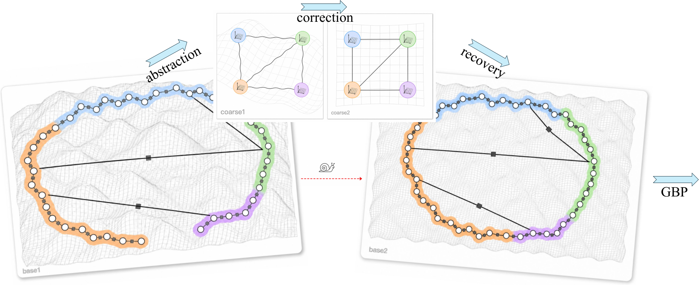
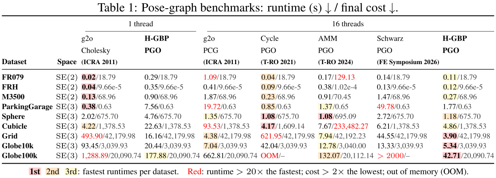
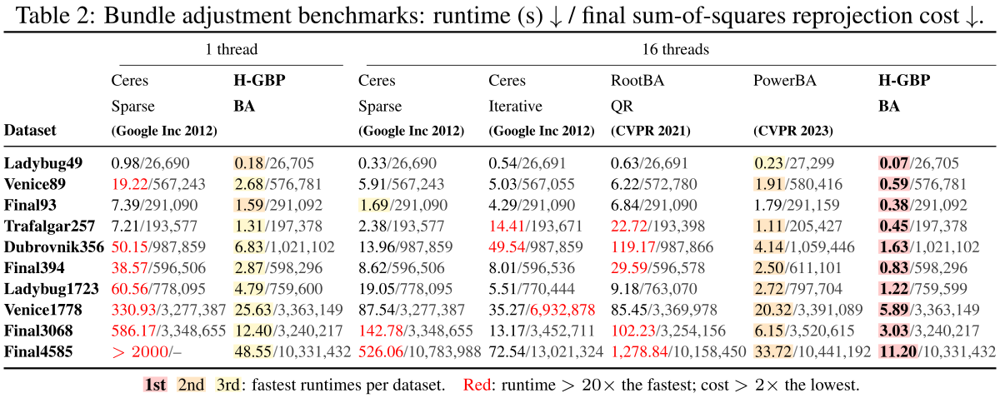

# H-GBP: Fast Bundle Adjustment and Pose Graph Optimization via Hierarchical Message Passing

[**Paper (arXiv)**](https://arxiv.org/abs/2610.06978)



High-performance CPU solvers for bundle adjustment and SE2/SE3 pose-graph
optimization, built around **hierarchical Gaussian belief propagation (H-GBP)**.

H-GBP combines **loopy Gaussian message passing** with **coarse-scale correction**
to couple local refinement and coordinated global updates. PGO uses a
reduced-basis hierarchy; BA applies GBP and connected coarse corrections to
the landmark-reduced camera system within a flexible conjugate-gradient solve.

Optimized fixed-size kernels, packed message storage and cached updates support
efficient single-threaded and parallel execution. See
[algorithm and policy details](code/docs/policies.md).

## Layout

```text
code/
  src/        Three solver entry points; private helpers in detail/
  apps/       PGO command-line frontends
  include/    C++ interfaces and kernels
  tests/      Numerical and runner regression tests
  variants/   Optional all-GBP coarse and SE2 CUDA implementations
  docs/       Policies, dependencies and project assets
benchmarks/
  configs/    Shared solver policies and pinned inputs
  baselines/  PGO and BA reproduction adapters
  datasets/   Synthetic generators and release tools
```

Build with `code/build.ps1`; download and run benchmarks with
`benchmarks/download.py` and `benchmarks/run.py`.
Start reading from [the solver entry points](code/docs/architecture.md).

Policies are shared across datasets within SE2, SE3 and BA respectively.
Dataset names select input metadata, not numerical parameter overrides.
`main` contains the maintained solvers and reproduction tools; `legacy`
preserves the preceding main version.

## Build

The validated environment is Windows x64, Visual Studio 2022, CMake/Ninja,
Python 3.10+, Eigen, SuiteSparse and OpenBLAS. BA also needs the compiled
RootBA dependency. See [dependencies](code/docs/dependencies.md) for the required
layout and runtime separation; dependencies and input data are not vendored.

```powershell
.\code\build.ps1 -DependencyRoot C:\deps -PGORuntimeDir C:\deps\pgo-runtime
ctest --test-dir build --output-on-failure
```

Use `-PGOOnly` to build without RootBA. Binaries are placed in `build/pgo`
and `build/ba`, preventing their different BLAS runtimes from being mixed.

## Benchmark inputs

The complete benchmark release is hosted on
[Hugging Face: HGBP-Benchmarks](https://huggingface.co/datasets/yuzhoucheng66/HGBP-Benchmarks):
**9 pose graphs** (3 SE2 and 6 SE3) and **10 bundle-adjustment problems**.
Download the exact inputs used by H-GBP and the baseline adapters:

```powershell
python benchmarks/download.py
```

The downloader verifies SHA-256 checksums and restores `data/pgo` and `data/ba`.
The release revision and manifest hash are pinned in
[`benchmarks/configs/data_release.json`](benchmarks/configs/data_release.json); the dataset card
records input provenance and preparation.
Use `--suite pgo`, `--suite ba` or `--datasets Sphere Ladybug49` for a subset.
For existing data, set `HGBP_PGO_DATA_ROOT` and `HGBP_BA_DATA_ROOT` instead.

## Run

```powershell
python benchmarks/run.py pgo --threads 16 --output-root results/reproduction/pgo
python benchmarks/run.py ba --threads 16 --output-root results/reproduction/ba
```

Use `--threads 1` for the serial path, `--compare-threads` for sequential
1/16-thread runs, or append dataset names to run a subset. Run `--help` for
custom inputs and runtime locations. No dataset-specific tuning is required.

Outputs record effective commands, input/binary hashes, native solver wall
time and process wall time separately. PGO reports its common quadratic
cost; BA reports squared reprojection cost, RMSE and mean reprojection error.
Numerical checks and timing diagnostics are separate: historical timings
are not portable performance guarantees.
The [cleanup validation](code/docs/recertification.md) records full BA,
sampled PGO and native SE2 CUDA checks against retained reference executables.

See [baseline reproduction](benchmarks/baselines/README.md) for comparison methods.
Input definitions and sources are documented in the dataset card; the
[Globe generators](benchmarks/datasets/README.md) reproduce the synthetic inputs.

### Reference results

Runtime [s] / final cost, from [Tables 1 and 2 of the paper](https://arxiv.org/abs/2610.06978v1).





<details>
<summary>Copyable numerical tables</summary>

**Pose-graph optimization**

| Dataset | Space | g2o-Cholesky<br>1 thread | **H-GBP PGO**<br>1 thread | g2o-PCG<br>16 threads | Cycle-PGO<br>16 threads | AMM-PGO<br>16 threads | Schwarz-PGO<br>16 threads | **H-GBP PGO**<br>16 threads |
| --- | :---: | ---: | ---: | ---: | ---: | ---: | ---: | ---: |
| FR079 | SE2 | 0.02/18.79 | 0.29/18.79 | 1.09/18.79 | 0.04/18.79 | 0.17/129.13 | 0.14/18.79 | 0.11/18.79 |
| FRH | SE2 | 0.04/9.66e-5 | 0.35/9.66e-5 | 0.41/9.66e-5 | 0.09/9.66e-5 | 0.38/1.02e-4 | 0.13/9.66e-5 | 0.12/9.66e-5 |
| M3500 | SE2 | 0.13/68.96 | 0.90/68.96 | 1.87/68.96 | 0.23/68.96 | 0.91/70.45 | 1.47/68.96 | 0.27/68.96 |
| ParkingGarage | SE3 | 0.38/0.63 | 7.56/0.63 | 19.72/0.63 | 0.85/0.63 | 1.37/0.65 | 49.78/0.63 | 1.77/0.63 |
| Sphere | SE3 | 2.02/675.70 | 4.76/675.70 | 1.35/675.70 | 1.08/675.70 | 1.08/695.09 | 2.72/675.70 | 1.18/675.70 |
| Cubicle | SE3 | 4.22/1,378.53 | 22.63/1,378.53 | 93.53/1,378.53 | 4.17/1,609.14 | 7.67/233,482.27 | 6.21/1,378.53 | 4.86/1,378.53 |
| Grid | SE3 | 493.90/42,179.98 | 16.16/42,179.98 | 4.38/42,179.98 | 621.95/42,179.98 | 7.94/42,192.23 | 44.55/42,179.98 | 3.90/42,179.98 |
| Globe10k | SE3 | 93.45/3,039.93 | 20.44/3,039.93 | 7.04/3,039.93 | 42.04/3,039.93 | 12.78/3,040.00 | 13.33/3,039.93 | 5.34/3,039.93 |
| Globe100k | SE3 | 1,288.89/20,090.74 | 177.88/20,090.74 | 662.81/20,090.74 | OOM/-- | 132.07/20,112.14 | >2000/-- | 42.71/20,090.74 |

**Bundle adjustment**

| Dataset | Ceres Sparse<br>1 thread | **H-GBP BA**<br>1 thread | Ceres Sparse<br>16 threads | Ceres Iterative<br>16 threads | RootBA-QR<br>16 threads | PowerBA<br>16 threads | **H-GBP BA**<br>16 threads |
| --- | ---: | ---: | ---: | ---: | ---: | ---: | ---: |
| Ladybug49 | 0.98/26,690 | 0.18/26,705 | 0.33/26,690 | 0.54/26,691 | 0.63/26,691 | 0.23/27,299 | 0.07/26,705 |
| Venice89 | 19.22/567,243 | 2.68/576,781 | 5.91/567,243 | 5.03/567,055 | 6.22/572,780 | 1.91/580,416 | 0.59/576,781 |
| Final93 | 7.39/291,090 | 1.59/291,092 | 1.69/291,090 | 4.29/291,090 | 6.84/291,090 | 1.79/291,159 | 0.38/291,092 |
| Trafalgar257 | 7.21/193,577 | 1.31/197,378 | 2.38/193,577 | 14.41/193,671 | 22.72/193,398 | 1.11/205,427 | 0.45/197,378 |
| Dubrovnik356 | 50.15/987,859 | 6.83/1,021,102 | 13.96/987,859 | 49.54/987,859 | 119.17/987,866 | 4.14/1,059,446 | 1.63/1,021,102 |
| Final394 | 38.57/596,506 | 2.87/598,296 | 8.62/596,506 | 8.01/596,536 | 29.59/596,578 | 2.50/611,101 | 0.83/598,296 |
| Ladybug1723 | 60.56/778,095 | 4.79/759,600 | 19.05/778,095 | 5.51/770,444 | 9.18/763,070 | 2.72/797,704 | 1.22/759,599 |
| Venice1778 | 330.93/3,277,387 | 25.63/3,363,149 | 87.54/3,277,387 | 35.27/6,932,878 | 85.45/3,369,978 | 20.32/3,391,089 | 5.89/3,363,149 |
| Final3068 | 586.17/3,348,655 | 12.40/3,240,217 | 142.78/3,348,655 | 13.17/3,452,711 | 102.23/3,254,156 | 6.15/3,520,615 | 3.03/3,240,217 |
| Final4585 | >2000/-- | 48.55/10,331,432 | 526.06/10,783,988 | 72.54/13,021,324 | 1,278.84/10,158,450 | 33.72/10,441,192 | 11.20/10,331,432 |

</details>

## GBP at every level

The optional [`pure_gbp`](code/variants/pure_gbp/README.md) variant retains
hierarchical abstraction and recovery while using GBP for fine smoothing and
both coarse levels, **without a coarse direct or Krylov solve**. Same-machine
16-thread, outer20 tests on all nine PGO inputs take **1.45-2.51x** the default
runtime, with a maximum final-cost increase of
**0.451%**. The faster coarse-direct route remains the default.
The independent folder contains the shared-policy configuration, build/run
instructions, numerical tests and [paired evidence](code/variants/pure_gbp/evidence/summary.json).
